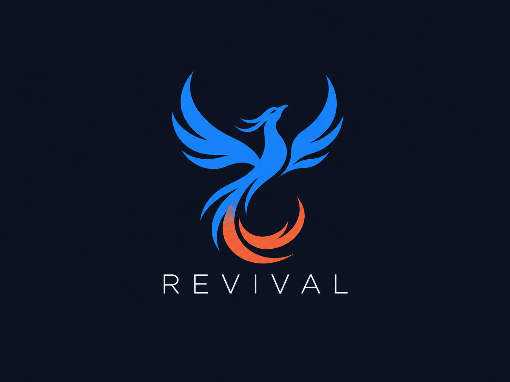

# Lenovo B8000-F Revival

**Giving an old tablet a second life.**

A community Android **7.1.2 / LineageOS 14.1** ROM for the **Lenovo B8000-F Wi-Fi** tablet.

Created and maintained by **Omar Bouhlal — [@omarbhl](https://github.com/omarbhl)**.

## About this project

This is a hobby project. I'm doing it for fun, learning along the way and trying to bring a piece of e-waste back to life.

I plan to keep working on it while this Android version remains useful and can run the apps I need. There's no fixed development schedule or promise of long-term support.

My main goal is to turn this tablet into a dashboard for **Home Assistant and PhoneBox**. I'm not using it as my everyday tablet, so testing and development mainly reflect that dashboard use case.

## What's working

The following features have been tested on my development tablet:

- Display and touchscreen alignment
- Automatic screen rotation
- Lock-screen rotation and sleep/wake behaviour
- Front and rear cameras, including preview orientation and photo capture
- Video recording
- Wi-Fi connectivity
- Bluetooth connectivity and audio
- Speakers, headphone output and microphone
- Volume and power buttons
- Charging
- USB connectivity and ADB
- Browser use and video playback

These are owner-reported manual results on the development tablet. The hardware fixes, About entries and wallpaper were also checked during development. The newly packaged release ZIP still needs its own clean-install and reinstall test in recovery. Please report anything that behaves differently on your tablet.

## Known issues

### microSD cards can prevent the tablet from booting

**Keep the microSD slot empty when using this ROM. Do not insert a microSD card.**

The current kernel lacks SELinux support. When the storage service scans an inserted microSD card, it attempts an unsupported SELinux operation and crashes. This can leave Android stuck during startup.

If the tablet gets stuck booting with a card inserted, remove the card. This issue still needs a compatibility fix.

### Old Android and kernel security limitations

This project uses an obsolete Android version and a legacy kernel without SELinux. It should not be considered a modern, secure platform for sensitive accounts or information.

Some newer apps will require a newer Android version or different hardware capabilities. The donor's advertised security patch date does not establish equivalent security coverage for the old kernel.

See [known issues and limitations](docs/KNOWN-ISSUES.md) for additional details.

## Google services and microG

**Google Play services and the Play Store are not included.**

With only **1 GB of RAM**, I'm keeping the system lightweight and leaving more resources available for useful apps.

I haven't tested **microG**. It may be an option if you need Google-service compatibility, but installation, required ROM support and individual app compatibility are currently unverified. Please share your results if you try it.

## Downloads and installation

See the [Releases page](https://github.com/omarbhl/lenovo-b8000f-lineageos14.1/releases) for available builds and their release-specific notes.

The current Revival release is **[v0.3](https://github.com/omarbhl/lenovo-b8000f-lineageos14.1/releases/tag/v0.3-revival)**, a community prerelease with the known SD-card issue. Download the ZIP and verify it using the published [SHA256 checksums](release/v0.3/SHA256SUMS.txt).

Before installing:

- Confirm that your device is the **Lenovo B8000-F Wi-Fi** model. B8000-H, B6000 and other variants are unsupported.
- Back up your data and keep a working recovery/rollback route.
- Remove any microSD card.
- Follow the [installation instructions](docs/INSTALLATION.md).
- Read the known issues for the exact release you download.

The installer writes boot and system; it does not automatically wipe userdata or replace recovery, bootloader or calibration. Moving from stock requires a separately performed, backed-up factory reset. Public-build defaults disable root ADB and include no pretrusted PC keys; existing userdata can retain previous development settings.

The original Settings colours are retained. The dark Settings preview was tested and reverted. The [Revival wallpaper](assets/revival-wallpaper.png) is available separately; it is not yet the ROM's default wallpaper. The separately tested Google WebView 119 update and per-user disabling of Updater/printing are not baked into this ZIP. See the release notes before assuming it reproduces every user-installed update on the development tablet.

## Contributing

**Contributions are more than welcome.**

Bug reports, testing, documentation, code improvements and hardware compatibility fixes all help keep this tablet useful.

Found an issue or want to contribute? Visit the project on GitHub:

- [Report an issue](https://github.com/omarbhl/lenovo-b8000f-lineageos14.1/issues)
- [Open a pull request](https://github.com/omarbhl/lenovo-b8000f-lineageos14.1/pulls)
- [Read the build instructions](docs/BUILDING.md)
- [Review the manual test checklist](docs/MANUAL-TEST-CHECKLIST.md)

When reporting a bug, include your ROM version, steps to reproduce it and relevant logs where possible. Remove personal information from logs before sharing them.

## Source and credits

This repository contains a portable workflow, pinned input/source links, hardware wrappers and compatibility patches for a donor-based port. It is not a complete source rebuild of every Android component or the exact stock kernel.

Thanks to AOSP, LineageOS, Lenovo/MediaTek, TeamYogaBlade/TeamYogaBlade2, the ASUS ME173X port developers and contributors, TeamWin, Open Camera and the wider device-porting community whose work made this project possible.

See [source and firmware dependencies](docs/SOURCES.md), [build-host dependencies](docs/DEPENDENCIES.md), [build verification](docs/BUILD-VERIFICATION.md) and [licensing/redistribution status](docs/LICENSING.md). Exact kernel-source correspondence and applicable third-party source/licensing obligations remain unresolved; publishing this repository does not establish that those requirements have been met. Upstream copyright and license terms remain applicable.

Private signing keys, device backups, account data, photos, Wi-Fi credentials, trusted ADB keys and unique calibration data are not uploaded.

## Disclaimer

**Flash and use this ROM at your own risk.**

This software is provided **AS IS**, without warranty. The author, maintainer and contributors are not responsible for device damage, bricking, data loss or other losses arising from installation or use, to the fullest extent permitted by applicable law.

This is an independent community project with no affiliation with or endorsement from Lenovo or the LineageOS project.
